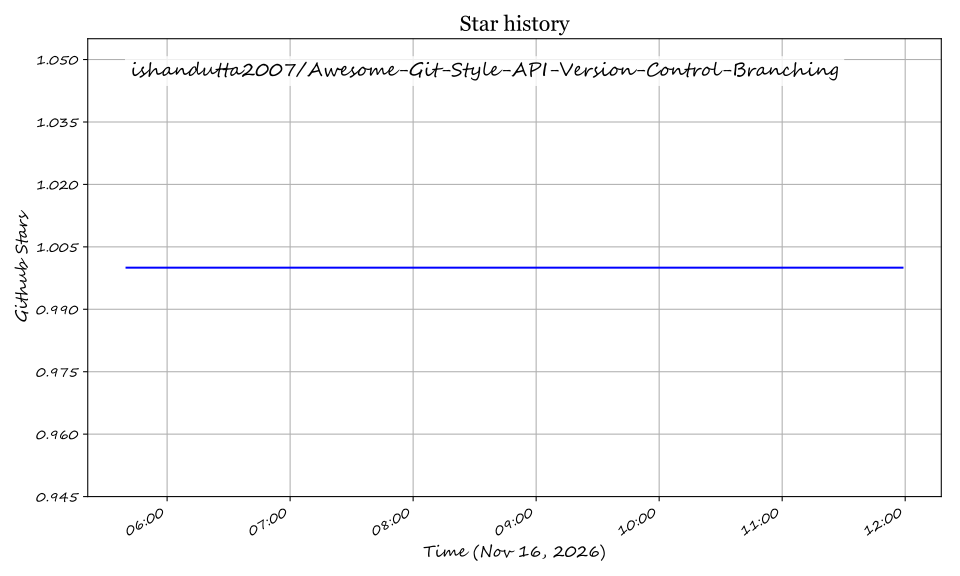

  

# 🚀 Awesome Git-Style API Version Control & Branching

  
  
  
  
  
  

  <strong>Curated ecosystem of SaaS platforms, self-hosted Git forges, and open-source tools for spec-first API version control, branching models, pull/merge requests, and contract review.</strong>

---

## 📌 Table of Contents

- [📖 Overview](#-overview)
- [📊 Sector Overview & Market Dynamics](#-sector-overview--market-dynamics)
- [☁️ SaaS/Hosted Platforms](#️-saashosted-platforms)
- [🔓 Open-Source GitHub Projects](#-open-source-github-projects)
  - [⭐ Top Tier Self-Hosted Git Forges & Code Review Tools](#-top-tier-self-hosted-git-forges--code-review-tools)
  - [🛠️ Alternative & Lightweight Version Control Systems](#️-alternative--lightweight-version-control-systems)
- [🤝 How to Contribute](#-how-to-contribute)
- [💖 Support & Sponsorship](#-support--sponsorship)
- [📈 Star History](#-star-history)
- [⚠️ Disclaimer](#️-disclaimer)

---

## 📖 Overview

This repository tracks notable **SaaS platforms** and **open-source projects** for **Git-Style API Version Control & Branching**. Modern engineering teams treat API contracts and OpenAPI specifications as first-class codebase artifacts. By applying standard Git workflows—isolated feature branches, pull/merge requests, peer reviews, CI/CD linters, and branch protection—teams prevent breaking changes, eliminate API drift, and maintain contract integrity across microservices.

- **Spec-First Versioning**: Developing and reviewing OpenAPI / AsyncAPI definitions prior to writing implementation code.
- **Branch Protection & Code Owners**: Enforcing strict branch policies, peer approvals, and schema validation rules before merging to production branches.
- **Data Sovereignty & Self-Hosting**: Leveraging lightweight and enterprise-ready open-source Git forges to manage contracts on-premises without per-seat licensing fees.

---

## 📊 Sector Overview & Market Dynamics

The Git version control and source code hosting sector represents an estimated **$6 billion** market (scaling toward **$12.8B+** by the 2030s), situated within the broader **$20B+** enterprise DevOps market. 

The sector is **highly concentrated at the top (a winner-take-most oligopoly)** dominated by Microsoft (GitHub, Azure Repos), GitLab, and Atlassian (Bitbucket), where network effects and platform consolidation (merging Git hosting, CI/CD, and AI developer tooling) heavily favor large unified suites over fragmented point tools. Simultaneously, open-source forges (such as Gitea, Gogs, and GitLab CE) serve a resilient, privacy-focused niche demanding on-premises deployment and complete contract sovereignty.

---

## ☁️ SaaS/Hosted Platforms

The table below lists leading SaaS solutions for Git hosting and branch workflows, sorted in descending order of parent company scale (Market Cap / Valuation):

| Product | Company Scale (Market Cap / Revenue) | Description | Pricing (Starting) | Free Tier / Trial Limits |
|---------|--------------------------------------|-------------|-------------------|--------------------------|
| **[Azure Repos](https://azure.microsoft.com/en-us/products/devops/repos/)** | **~$3.89T MCap** (~$346B Rev, Microsoft) | **Git repositories within Azure DevOps with branch policies.** Supports **Git (distributed) or TFVC (centralized)**—Git is the default for new projects. **Branch policies** enforce required reviewers, linked work items, and successful builds before merge. | **$6/user/month** (Basic plan, starting from 6th user) | **Free forever**: first 5 users free with unlimited private Git repos, 1 parallel job (1,800 min/mo for CI/CD) |
| **[GitHub](https://github.com/)** | **~$3.89T MCap** (~$346B Rev, Microsoft) | **The default Git forge with the most mature pull request workflow.** Branch protection rules, required reviews, CODEOWNERS enforcement, and status checks gate merges to protected branches. **API specifications live alongside code**—a spec PR is a design review with inline comments that survive in the merge history. | **$4/user/month** (Team plan) | **Free forever**: unlimited public & private repositories, 2,000 GitHub Actions minutes/month, 500MB Packages storage |
| **[AWS CodeCommit](https://aws.amazon.com/codecommit/)** | **~$2.88T MCap** (~$777B Rev, Amazon) | **Managed Git with API-driven branch and merge operations.** **Three merge strategies** exposed via API: `MergeBranchesByFastForward`, `MergeBranchesBySquash`, and `MergeBranchesByThreeWay`—same options for pull request merges. **Repository triggers** fire on branch/tag events; approval rule templates enforce required approvals. | **$1/user/month** (starting from 6th active user) | **Free forever**: first 5 active users/month, 50 GB storage/month, and 10,000 Git requests/month |
| **[Bitbucket Cloud](https://bitbucket.org/)** | **~$39B MCap** (~$6.57B Rev, Atlassian) | **Git hosting with native Jira integration.** **15 million developers** use Bitbucket; every changed line links back to a Jira work item for traceability. Branch permissions and pull request approvals enforce review discipline. | **$3.65/user/month** (Standard plan) | **Free forever**: up to 5 users, unlimited private repositories, 50 build minutes/month, 1 GB LFS storage |
| **[GitLab](https://gitlab.com/)** | **~$8B MCap** (~$1.06B TTM Rev, GitLab Inc.) | **Integrated DevOps platform with merge requests, CI/CD, and branch protection.** **Merge requests capture metadata** (reason for change, summary, impact) that traditional change requests buried in docx files. **Feature branches replace CR bodies**; discussions stay attached to the branch and merge request. | **$29/user/month** (Premium plan, billed annually) | **Free forever**: up to 5 users per namespace, 5 GiB storage, 400 compute (CI/CD) minutes/month |

---

## 🔓 Open-Source GitHub Projects

Curated list of self-hosted Git forges, distributed code review engines, and repository managers. 

> [!NOTE]  
> All repositories below are **sorted in descending order by GitHub stargazers count**. Each badge links directly to the project's stargazers page.

### ⭐ Top Tier Self-Hosted Git Forges & Code Review Tools

| Project | Stars_Badge | Description |
|---------|------------|-------------|
| **[Gitea](https://github.com/go-gitea/gitea)** |  | **The most popular lightweight self-hosted Git forge.** Written in Go and MIT-licensed, running comfortably in **~100 MB RAM** on a Raspberry Pi. Provides **merge requests, branch protection, CODEOWNERS, and webhooks** for spec-first API workflows. Use `tea` CLI for terminal operations. |
| **[Gogs](https://github.com/gogs/gogs)** |  | **A painless self-hosted Git service.** The original ultra-lightweight Go-based Git forge that inspired Gitea. Features an exceptionally simple setup, low resource consumption, basic pull requests, and webhooks suitable for minimalist teams. |
| **[GitLab CE](https://github.com/gitlabhq/gitlabhq)** |  | **Complete open-source DevOps platform with merge requests, CI/CD, and branch protection.** Self-managed Community Edition includes `.gitlab-ci.yml` pipelines, external repo integrations, and container registries for end-to-end API lifecycle automation. |
| **[OneDev](https://github.com/theonedev/onedev)** |  | **Self-hosted Git server with built-in CI/CD and code intelligence.** MIT licensed. Combines pull request review workflows with symbol navigation, outline queries, and customizable build pipelines without the heavy footprint of GitLab CE. |
| **[git-bug](https://github.com/git-bug/git-bug)** |  | **Distributed bug tracker embedded entirely inside Git.** Stores issues and review metadata directly as Git objects, enabling offline issue management, distributed branching, and zero vendor lock-in for API documentation bug triage. |
| **[GitBucket](https://github.com/gitbucket/gitbucket)** |  | **A GitHub clone powered by Scala with easy installation.** Operates as a single executable JAR file. Offers GitHub-like pull requests, branch protection, issue tracker, wiki, and plugin extensibility. |
| **[Soft Serve](https://github.com/charmbracelet/soft-serve)** |  | **A tasty, self-hosted Git server for the terminal.** Developed by Charm in Go; provides SSH-first repository browsing, TUI management, key-based ACL permissions, and lightweight Git branching for terminal enthusiasts. |
| **[Git-Appraise](https://github.com/google/git-appraise)** |  | **Distributed code review system for Git repos.** Created by Google; stores code review comments, approvals, and build statuses directly as Git notes (`refs/notes/devtools`), ensuring reviews travel with the repository independent of the forge. |
| **[Gerrit Code Review](https://github.com/GerritCodeReview/gerrit)** |  | **Rigorous commit-by-commit pre-merge review system.** Uses the **magic branch workflow** (`refs/for/master`), where every commit becomes a reviewed unit with a Change-Id hook. Ideal for projects demanding atomic, linear review histories for API contracts. |

---

### 🛠️ Alternative & Lightweight Version Control Systems

- **[Forgejo](https://codeberg.org/forgejo/forgejo)**: A community-governed, copyleft (GPLv3+) fork of Gitea focused on decentralization, federation via ForgeFed/ActivityPub, and software freedom. Hosted on Codeberg.
- **[Kallithea](https://kallithea-scm.org/)**: Member project of the Software Freedom Conservancy providing a self-hosted Git and Mercurial repository management platform with pull requests and code review.
- **[RhodeCode](https://rhodecode.com/)**: Enterprise source code management with unified support for Git, SVN, and Mercurial.

---

## 🤝 How to Contribute

Contributions are welcome! To contribute:

1. 🍴 Fork the repository.
2. 📝 Add or update entries in `README.md` following the existing format.
3. 🔍 Ensure descriptions are objective, links are working, and Stars_Badges link to `/stargazers`.
4. 🚀 Submit a Pull Request with a clear description of the addition.

---

## 💖 Support & Sponsorship

If you find this curated collection helpful for your engineering workflows or architectural decisions:

- ⭐ **Star** this repository to help others discover it.
- 🍴 **Fork** and share it with your teammates and community.
- ☕ **Buy me a coffee**: Support ongoing curation and open-source tooling directly on the [GitHub Sponsors Dashboard](https://github.com/sponsors/ishandutta2007).

Thank you for supporting open-source software!

---

##  Star History

---

## ⚠️ Disclaimer

- This is a **community-curated list** — not exhaustive and not an official endorsement.
- Git forges and branching workflows govern how API specifications and code change; enforce branch protection, required reviews, and CODEOWNERS to prevent unreviewed contract changes from reaching production.
- **Branching model choice matters more for API specs than for application code.** **Trunk-based development** (short-lived branches, frequent merges to `main`) keeps the spec close to a single line of truth—**most API teams should prefer this**. **Gitflow** (long-running `develop` and `release` branches) lets the spec drift on `develop` and produces **bigger, riskier YAML merge conflicts** when two branches restructure the same file. 
- **Gerrit's model is fundamentally different**: you don't create a feature branch and open a PR—you push each commit to `refs/for/<branch>`, and the `commit-msg` hook generates a Change-Id that tracks patch sets through review. This enforces a **linear history where every commit is reviewed**, but requires a mental model shift from GitHub-style PRs.

---

  Made with ❤️ for API architects, platform engineers, and teams treating specifications as code.

## ⭐ Star History

<a href="https://star-history.com/#ishandutta2007/Awesome-Git-Style-API-Version-Control-Branching&Timeline" align="center">
  <picture>
    <source media="(prefers-color-scheme: dark)" srcset="assets/ishandutta2007_Awesome-Git-Style-API-Version-Control-Branching_growth.svg">
    
  </picture>
</a>
